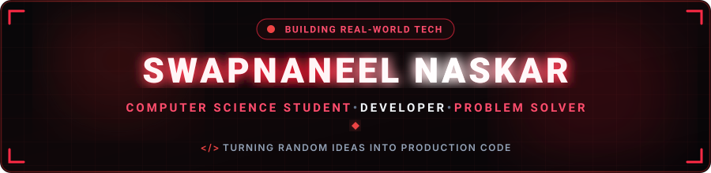
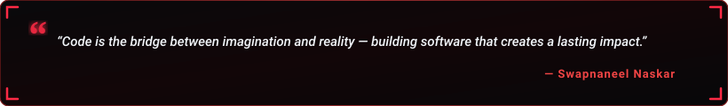

  

  

  
  &nbsp;
  
  &nbsp;
  
  &nbsp;
  

  

---

### 🌐 Official Interactive Portfolio Website
**[👉 Launch Live Website: swapnaneelnaskar.github.io ↗](https://swapnaneelnaskar.github.io/)**

*Noir & Crimson Cybernetic Architecture • 7-Layer Architectural Stack Explorer • Multi-Agent Swarm Rebuild Engine*

---

<h2 align="center">🔴 Executive Summary &amp; Bio</h2>

  

  

  Hey there! I'm <b>Swapnaneel Naskar</b>, an aspiring <b>Software Engineer &amp; Full-Stack Systems Developer</b> currently pursuing a <b>B.Tech in Computer Science &amp; Engineering</b> at <b>Techno India University</b>, Kolkata.  
  I specialize in building intelligent web applications, client-side biometric verification portals, AI-powered cybersecurity heuristics, and core computer science algorithms. From architecting deterministic state flows to optimizing multi-vertical logistics platforms, I enjoy transforming complex engineering problems into clean, production-grade software.

  
  &nbsp;
  
  &nbsp;
  
  &nbsp;
  

  💬 <b>Technical Focus:</b> Systems Architecture, React 19, Client-Side Biometrics, Machine Learning, Data Structures &amp; Algorithms. 
  ⚡ <b>Engineering Philosophy:</b> <i>"Code is the bridge between imagination and reality — building software with deterministic precision and zero compromise."</i>

---

<h2 align="center">🚀 Production Deployments &amp; Repositories Matrix</h2>

<i>Comprehensive index of all production software systems, live web portals, and open-source repositories:</i>

<table width="100%" border="0" align="center">
<thead>
<tr style="background: rgba(239,68,68,0.15);">
  <th align="left" style="padding: 10px;"><b>System / Repository</b></th>
  <th align="left" style="padding: 10px;"><b>Core Stack</b></th>
  <th align="center" style="padding: 10px;"><b>Live Application</b></th>
  <th align="center" style="padding: 10px;"><b>Source Code</b></th>
</tr>
</thead>
<tbody>
<tr>
  <td style="padding: 12px; border-bottom: 1px solid rgba(255,255,255,0.08);">
    <b>🌐 <a href="https://github.com/SwapnaneelNaskar/SwapnaneelNaskar.github.io">SwapnaneelNaskar.github.io</a></b> 
    Noir &amp; Crimson Cybernetic Developer Portfolio with Swarm Rebuild Engine &amp; 7-Layer Architecture
  </td>
  <td style="padding: 12px; border-bottom: 1px solid rgba(255,255,255,0.08);">
    <code>HTML5</code> <code>CSS3 Op-Art</code> <code>JavaScript</code> <code>Web Audio</code>
  </td>
  <td align="center" style="padding: 12px; border-bottom: 1px solid rgba(255,255,255,0.08);">
    
  </td>
  <td align="center" style="padding: 12px; border-bottom: 1px solid rgba(255,255,255,0.08);">
    
  </td>
</tr>

<tr>
  <td style="padding: 12px; border-bottom: 1px solid rgba(255,255,255,0.08);">
    <b>🎓 <a href="https://github.com/SwapnaneelNaskar/student-info-portal">student-info-portal</a></b> 
    React 19 Academic Portal with on-device FaceAPI Biometrics, SSO Hierarchy &amp; CGPA Rank Sorter
  </td>
  <td style="padding: 12px; border-bottom: 1px solid rgba(255,255,255,0.08);">
    <code>React 19</code> <code>FaceAPI.js</code> <code>WASM</code> <code>Tailwind</code>
  </td>
  <td align="center" style="padding: 12px; border-bottom: 1px solid rgba(255,255,255,0.08);">
    
  </td>
  <td align="center" style="padding: 12px; border-bottom: 1px solid rgba(255,255,255,0.08);">
    
  </td>
</tr>

<tr>
  <td style="padding: 12px; border-bottom: 1px solid rgba(255,255,255,0.08);">
    <b>🛡️ <a href="https://github.com/SwapnaneelNaskar/AiScamDetection_Website">AiScamDetection_Website</a></b> 
    AI Threat Intelligence Application with NLP Phishing Parsing, Multi-Photo OCR &amp; Shannon URL Entropy
  </td>
  <td style="padding: 12px; border-bottom: 1px solid rgba(255,255,255,0.08);">
    <code>Python</code> <code>scikit-learn</code> <code>FastAPI</code> <code>Tesseract OCR</code>
  </td>
  <td align="center" style="padding: 12px; border-bottom: 1px solid rgba(255,255,255,0.08);">
    
  </td>
  <td align="center" style="padding: 12px; border-bottom: 1px solid rgba(255,255,255,0.08);">
    
  </td>
</tr>

<tr>
  <td style="padding: 12px; border-bottom: 1px solid rgba(255,255,255,0.08);">
    <b>⚡ <a href="https://github.com/SwapnaneelNaskar/bharat-astra">bharat-astra</a></b> 
    Next-Gen Indian Transit &amp; Commerce Platform: 177+ Products, 68 Airports, 18 Railway Zones &amp; 305+ Theaters
  </td>
  <td style="padding: 12px; border-bottom: 1px solid rgba(255,255,255,0.08);">
    <code>JavaScript ES6+</code> <code>HTML5</code> <code>CSS3</code> <code>Responsive</code>
  </td>
  <td align="center" style="padding: 12px; border-bottom: 1px solid rgba(255,255,255,0.08);">
    
  </td>
  <td align="center" style="padding: 12px; border-bottom: 1px solid rgba(255,255,255,0.08);">
    
  </td>
</tr>

<tr>
  <td style="padding: 12px; border-bottom: 1px solid rgba(255,255,255,0.08);">
    <b>🌦️ <a href="https://github.com/SwapnaneelNaskar/weather_web">weather_web (NEXUS Weather)</a></b> 
    Interactive Meteorological Radar Map with Live Geolocation Telemetry &amp; Glassmorphism UI
  </td>
  <td style="padding: 12px; border-bottom: 1px solid rgba(255,255,255,0.08);">
    <code>Leaflet.js</code> <code>OpenWeather API</code> <code>Geolocation</code> <code>CSS3</code>
  </td>
  <td align="center" style="padding: 12px; border-bottom: 1px solid rgba(255,255,255,0.08);">
    
  </td>
  <td align="center" style="padding: 12px; border-bottom: 1px solid rgba(255,255,255,0.08);">
    
  </td>
</tr>
</tbody>
</table>

---

<h2 align="center">🔴 Featured Architectural Spotlights</h2>

<table width="100%" border="0" align="center">
<tr>
<td width="100%" align="center" style="padding: 24px; border: 1px solid rgba(239,68,68,0.35); border-radius: 12px; background: #0c0709;">
  <h3>🎓 Student Information Portal — React 19 Academic Ecosystem</h3>
  
<i>An ultra-modern academic portal architected in React 19 featuring concurrent state transitions, unidirectional prop hierarchies, immutable O(N log N) student CGPA sorting, and real-time on-device biometric neural face verification running client-side with zero cloud privacy leakage.</i>

  

    
    &nbsp;
    
    &nbsp;
    
    &nbsp;
    
  

  

    <code>React 19 Concurrent Actions</code> • <code>FaceAPI.js (68 Landmarks &amp; 128-d Vector Math)</code> • <code>Deterministic Sorter</code> • <code>Role-Based SSO</code>
  

   
  

    
    &nbsp;
    
  

</td>
</tr>

<tr><td height="16"></td></tr>

<tr>
<td width="100%" align="center" style="padding: 24px; border: 1px solid rgba(239,68,68,0.35); border-radius: 12px; background: #0c0709;">
  <h3>🛡️ CyberShield — AI Scam &amp; Threat Detection Web Platform</h3>
  
<i>A real-time cybersecurity intelligence application combining machine learning (scikit-learn NLP), explainable heuristic rules, technical URL entropy &amp; TLD inspection, and client-side multi-photo OCR (Tesseract.js WebAssembly) to detect scam messages, fake delivery fees, banking phishing, and malicious URLs with 85%–98% calibrated accuracy.</i>

  

    
    &nbsp;
    
    &nbsp;
    
    &nbsp;
    
    &nbsp;
    
  

  

    <code>Python (NLP &amp; ML)</code> • <code>JavaScript (DOM &amp; WebAssembly OCR)</code> • <code>HTML5 / Tailwind CSS</code> • <code>SQLite Database</code>
  

   
  

    
    &nbsp;
    
  

</td>
</tr>

<tr><td height="16"></td></tr>

<tr>
<td width="100%" align="center" style="padding: 24px; border: 1px solid rgba(239,68,68,0.3); border-radius: 12px; background: #0c0709;">
  <h3>⚡ Bharat Astra — Next-Gen National Logistics &amp; Commerce Platform</h3>
  
<i>A unified, high-concurrency commerce and logistics platform coordinating 177+ commercial products across 14 categories, 68 national and international airport hubs, 18 Indian Railways zones, and 305+ cinema complexes across major Indian metro zones with instant side-by-side spec filtering.</i>

  

    
    &nbsp;
    
    &nbsp;
    
    &nbsp;
    
  

  

    <code>Multi-Vertical Orchestration</code> • <code>Spec Comparison Matrix</code> • <code>Zero-Lag Viewport Filtering</code>
  

   
  

    
    &nbsp;
    
  

</td>
</tr>

<tr><td height="16"></td></tr>

<tr>
<td width="100%" align="center" style="padding: 24px; border: 1px solid rgba(239,68,68,0.3); border-radius: 12px; background: #0c0709;">
  <h3>🌦️ NEXUS — Interactive Weather + Map Analytics</h3>
  
<i>A responsive, dynamic real-time weather analytics application featuring automatic geolocation tracking, interactive Leaflet.js mapping, multi-metric climate indicators, instant city search, and a modern glassmorphic interface.</i>

  

    <code>HTML5</code> • <code>CSS3 / Glassmorphism</code> • <code>JavaScript ES6+</code> • <code>Leaflet.js Maps</code> • <code>RESTful Weather APIs</code> • <code>Geolocation API</code>
  

   
  

    
    &nbsp;
    
  

</td>
</tr>
</table>

---

<h2 align="center">🧩 Algorithmic Problem Solving &amp; Core Fundamentals</h2>

<i>Live real-time tracker of coding challenges, algorithmic milestones, and competitive problem solving:</i>

  <code>Data Structures</code> • <code>Algorithms</code> • <code>Time &amp; Space Complexity Optimization</code> • <code>C++ / Java / Python / C</code>

---

<h2 align="center">🛠️ Technical Stack &amp; Competencies</h2>

<b>Core Programming Languages</b>

  

<b>Frontend &amp; UI Architecture</b>

  

<b>Backend, Databases &amp; Core Stack</b>

  

<b>DevOps, Platforms &amp; Engineering Tools</b>

  

  
  &nbsp;
  
  &nbsp;
  
  &nbsp;
  
  &nbsp;
  

<b>📚 Click to Expand: Core CS Coursework &amp; Fundamentals</b>

 

  <table>
    <tr>
      <td><b>Data Structures &amp; Algorithms</b></td>
      <td>Arrays, Linked Lists, Stacks, Queues, Binary Search Trees, Sorting, Recursion</td>
    </tr>
    <tr>
      <td><b>Database Management Systems</b></td>
      <td>SQL, Relational Schema Normalization, Query Optimization, ACID transactions</td>
    </tr>
    <tr>
      <td><b>Computer Networks</b></td>
      <td>TCP/IP, HTTP/HTTPS, DNS, Sockets, Client-Server Architecture, REST APIs</td>
    </tr>
    <tr>
      <td><b>Operating Systems</b></td>
      <td>Process Scheduling, Concurrency, Memory Management, Linux CLI, Shell</td>
    </tr>
    <tr>
      <td><b>Object-Oriented Design</b></td>
      <td>Encapsulation, Inheritance, Polymorphism, Abstraction, Clean Code</td>
    </tr>
  </table>

---

<h2 align="center">📊 GitHub Analytics &amp; Global Activity</h2>

  
  &nbsp;&nbsp;
  

  

  

---

<h2 align="center">⚡ Contribution Journey</h2>

  

---

<h2 align="center">📬 Let's Connect &amp; Collaborate</h2>

<i>Whether you want to discuss full-stack architecture, software engineering opportunities, or explore exciting open-source collaborations — my inbox is always open!</i>

<table border="0" align="center">
<tr>
<td align="center" width="200" style="padding: 18px; border: 1px solid rgba(239,68,68,0.25); border-radius: 12px; background: #0c0709;">
  <a href="https://www.linkedin.com/in/swapnaneel-naskar-70245a315/" target="_blank">
    
      
    
  </a>
    
  <b>Professional Network</b>
</td>
<td align="center" width="200" style="padding: 18px; border: 1px solid rgba(239,68,68,0.25); border-radius: 12px; background: #0c0709;">
  <a href="https://github.com/SwapnaneelNaskar" target="_blank">
    
      
    
  </a>
    
  <b>Projects &amp; Code</b>
</td>
<td align="center" width="200" style="padding: 18px; border: 1px solid rgba(239,68,68,0.25); border-radius: 12px; background: #0c0709;">
  <a href="mailto:swapnaneelnaskar2006@gmail.com">
    
      
    
  </a>
    
  <b>Direct Communication</b>
</td>
<td align="center" width="200" style="padding: 18px; border: 1px solid rgba(239,68,68,0.25); border-radius: 12px; background: #0c0709;">
  <a href="https://x.com/ArghyaNaskar07" target="_blank">
    
      
    
  </a>
    
  <b>Social &amp; Updates</b>
</td>
</tr>
</table>

  

